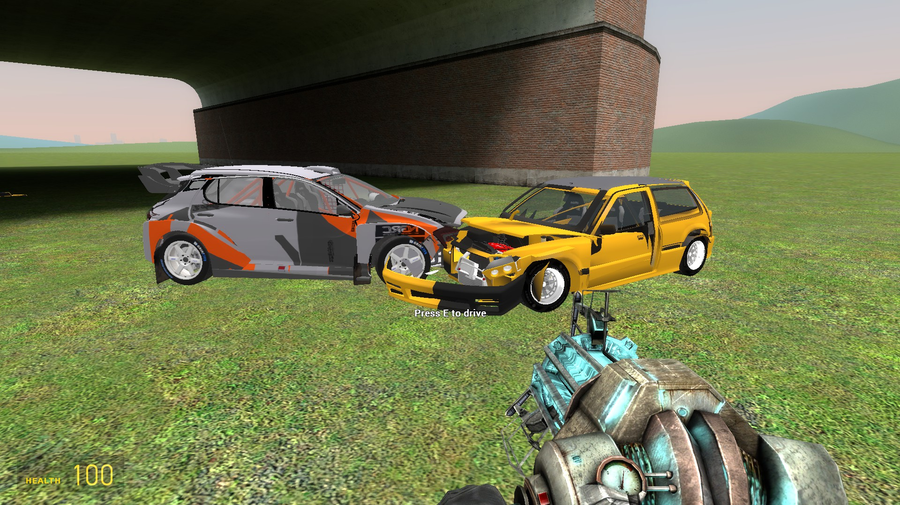
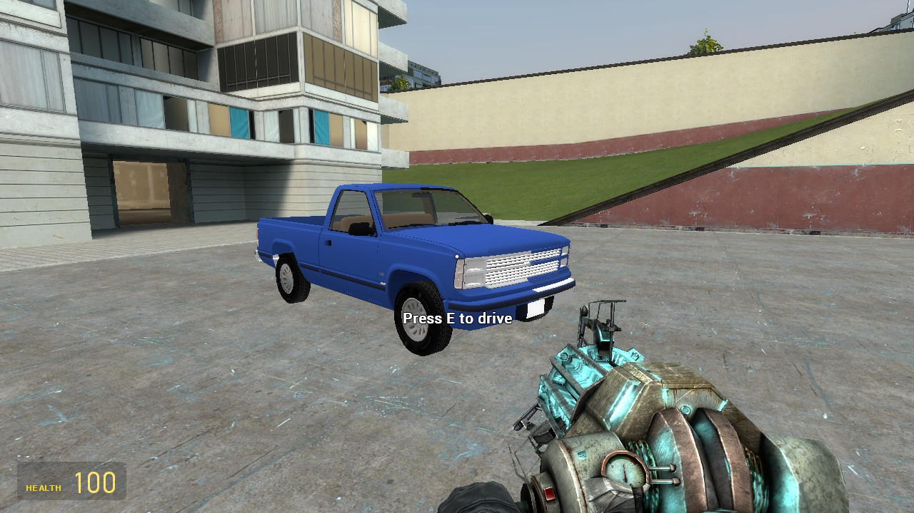

# Games_meshup
# BeamGMod: BeamNG.drive cars in Garry's Mod

Making garry's mod x BeamNG 

make sure the launcher at steamapps\common\launcher (here)

steamapps\common\BeamNG.drive\scripts\beamng-mod ...

steamapps\common\GarrysMod\garrysmod\ addons and data.

in gmod console type bg_help and 

70% done.

when cars load it will lag for some seconds based on the cars model.

Make sure to clean (garrysmod\data\beamgmod\models) after some time.

BeamNG does the car physics, damage and sound. Garry's Mod is the host: it draws the car (from
BeamNG's node positions), moves your player with it, and gives BeamNG a ground to drive on.
It reuses BeamNG-side mod (`mccross`).

## Start

Double-click `play.bat` (or `play.bat flat`, `play.bat terrain`).

| Mode | Map | What BeamNG drives on |
|---|---|---|
| 1 flat | gm_flatgrass | BeamNG's own flat floor, lined up with the map's floor |
| 2 terrain | gm_construct | a heightmap sampled from the map (512 m around where you spawn) and built as BeamNG terrain |

Options: `-Car etk800 -Config 854_base`, `-Map gm_fork`, `-CloseBeamNG`.
Mode 3 (the overlay inside BeamNG) is not part of this.

## Controls (in game)

| Key | |
|---|---|
| E | get in / out (near the car) |
| W / S | gas / brake (hold S at a standstill for reverse) |
| A / D | steer |
| Space | handbrake |
| R | flip the car back onto its wheels and repair it, where it is |
| Left mouse | horn |
| Right mouse | lights |
| B | camera: chase, orbit (mouse), hood |
| C (context menu) -> BeamNG icon, or `bg_menu` | pick any BeamNG car and configuration |

Shooting the car dents it, explosions near it push it around.

Console: `bg_help`, `bg_status`, `bg_spawn <model> [config]`, `bg_remove`, `bg_reset`, `bg_here`,
`bg_ignite`, `bg_extinguish`, `bg_boom`, `bg_launch`, `bg_next`, `bg_cam`, `bg_restart`,
`bg_steer_invert 1` (if left and right are swapped), `bg_debug 1` (log every BeamNG message),
`bg_terrain_size 256|512|1024`, `bg_terrain_square <metres per sample>`.

## How it fits together

```
GMod (Lua)  <--files-->  BeamGmodRelay (Java)  <--UDP 127.0.0.1:47020-->  BeamNG + mccross
 garrysmod/data/beamgmod/in  and  out
```

GMod's Lua cannot open sockets, so the relay does the protocol (hello, ping, session
ids) and exchanges plain JSON files with the addon. Everything is in `garrysmod/addons/beamgmod`.
BeamNG's world is metres with Z up, the same axes as GMod, so the mapping is only a scale
(39.37 units per metre) and an offset (the ground point under you at start).

## Limits

- Single player or listen server only (the relay's files are on the host's disk).
- The car is drawn as a flat-shaded copy of BeamNG's skin, not the textured model.
- GMod props and NPCs do not stop the car (BeamNG does not know about them). Map walls are only
  solid in terrain mode where the ground is a heightmap, and even there only the ground.
- Terrain mode is meant for open maps; roofs and bridges become part of the "ground".
  The terrain covers 512 m around the start; past its edge there is nothing.
- Flat mode assumes the map's floor is flat (gm_flatgrass).
- If `beamng_mashup` (the older addon) is installed, rename its folder so it does not run too.

## Troubleshooting

- `relay.log` and `relay.log.err` (this folder): the relay's output.
- `garrysmod/console.log` (play.bat starts GMod with `-condebug`): look for `[BeamGMod]` lines.
- In game: `bg_status` prints the stage, relay and BeamNG state.
- Nothing appears in game: open the console, run `bg_status`. `relay=false` means play.bat's relay
  is not running; `connected=false` means BeamNG is not up.




